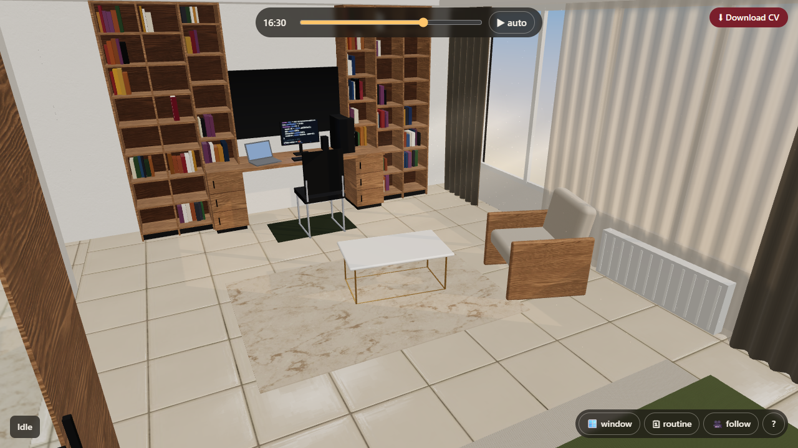
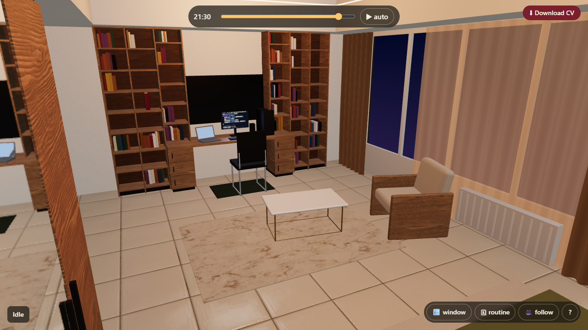
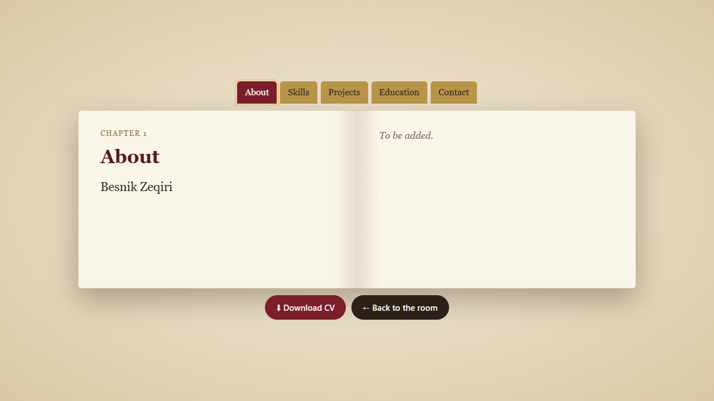
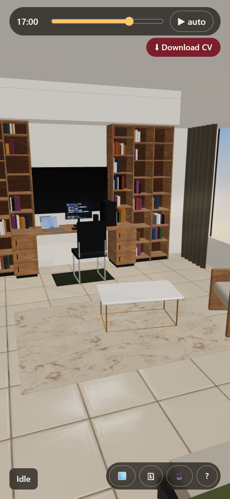

# Cozy Room: An Interactive 3D Portfolio

A small interactive 3D scene built with **three.js**: a stylized rebuild of my real study room, where a character lives through the day. You walk the character around, make it work at the desk, read or sleep, change the time of day with a slider, and open the red book on the shelf to read my portfolio.

Final project for **Computer Graphics (CCS-601)**, SEEU, 2026/27, Prof. Dr. Visar Shehu. Individual project by Besnik Zeqiri.

**Live demo:** <https://bz32125.github.io/3d-portfolio-room/> (published by GitHub Actions from `main`; see [Deploy](#deploy)).



| Night | Portfolio book | Phone |
| --- | --- | --- |
|  |  |  |

## Run it

Requires Node.js 18+.

```bash
npm install
npm run dev      # development server, usually http://localhost:5173
npm run build    # production build in dist/
npm run preview  # serve the production build
```

Development helpers (URL parameters): `?t=21` jumps to 21:00, `?cam=x,y,z&target=x,y,z` places the camera and skips the title screen. In `npm run dev` an FPS / draw-call counter is shown and `window.__app` gives console access to the scene.

## Controls

| Action | Desktop | Phone |
| --- | --- | --- |
| Walk | click the floor | tap the floor |
| Work / read / sleep | click the chair / armchair / bed | tap |
| Open the portfolio | click the red book on the shelf | tap |
| Look around / zoom | drag / mouse wheel | one-finger drag / pinch |
| Time of day | slider at the top, **▶ auto** lets time run (1 h ≈ 10 s) | same |
| Window open (more wind in the curtains) | 🪟 | same |
| Character follows the clock | 🗓 routine | same |
| Camera follows the character | 🎥 follow | same |
| Help | **?** button, or the H / ? keys | **?** button |
| Close the book | **Back to the room** or Esc | **Back to the room** |
| Download CV | top-right button, or inside the book | same |

The game starts with a title screen; **Enter** starts the intro: the character walks in from the corridor and the camera eases into the room.

## Computer Graphics techniques: where they are in the code

| Rubric technique | What is shown | File → function |
| --- | --- | --- |
| **Lighting** | 4 light types: `HemisphereLight`, `DirectionalLight` sun with shadows, `PointLight` (LED cove + bedside lamps), `RectAreaLight` (monitor glow). Sun position, intensity and colour from hour keyframes. Shadow camera fitted tightly around the room each time the sun moves; `bias` / `normalBias` tuned against acne and peter-panning. The right wall has a real window opening and the room shell casts shadows, so sun only enters through the window. Fake light shafts with additive blending and cylindrical billboarding. | `src/lighting/dayCycle.js` → `DayCycle.setTime`, `fitShadowCamera`; `src/lighting/roomLights.js` → `createRoomLights`, `setNight`; `src/lighting/lightShafts.js` → `faceCamera`; `src/world/room.js` → `rightWallAroundWindow` |
| **Colour** | sRGB output (`outputColorSpace`), `colorSpace = SRGBColorSpace` only on colour maps (normal/roughness stay linear), ACES filmic tone mapping with exposure that changes from day to night; colour keyframes interpolated in linear space; sky gradient through vertex colours. | `src/core/renderer.js` → `createRenderer`; `src/materials/textures.js` → `loadTexture`; `src/lighting/keyframes.js` → `sampleColor`; `src/world/windowWall.js` → `createSky` |
| **Textures** | Colour + normal + roughness maps (CC0), `RepeatWrapping` + `repeat` in metres, mipmaps, anisotropic filtering at the GPU maximum; UVs scaled to real size so the grain is the same on every board; CanvasTextures for the monitor code, the book title page, light shafts and dust. | `src/materials/textures.js` → `loadTexture`, `applyAnisotropy`; `src/utils/box.js` → `scaleBoxUvs`, `metricPlane`; `src/world/monitorScreen.js` |
| **PBR** | Rough walnut, polished tiles, chrome and gold (metalness 1), mirror (metalness 1, roughness 0.02), fabric with `sheen`, leather and TV with `clearcoat` (`MeshPhysicalMaterial`); environment map from `RoomEnvironment` via `PMREMGenerator`, weaker at night; real-time `Reflector` for the wardrobe mirror on desktop. | `src/materials/materials.js`; `src/lighting/environment.js` → `createEnvironment`; `src/world/wardrobe.js` → `createMirror` |
| **Own ShaderMaterial** | Curtains: vertex shader makes folds + wind (amplitude grows toward the bottom) and recomputes the normal analytically; fragment shader does lambert + rim, an animated colour shift, back-lit translucency inside the window rectangle and alpha for the sheer curtain. Uniforms `uTime, uWind, uSunIntensity, uSunColor, uSunDir, uBaseColor…`, varyings `vUv, vNormal, vWorldPos`. | `src/shaders/curtain.vert.glsl`, `src/shaders/curtain.frag.glsl`; `src/materials/curtainMaterial.js` → `createCurtainMaterial`, `updateCurtains` |
| **Animation** | Everything uses delta time, clamped to 0.05 s so nothing jumps when the tab regains focus; easing for the camera, the time slider and the book; `AnimationMixer` with 0.3 s crossfades; walk speed measured from the walk clip (no foot sliding); Promise-based tweens chained with `await`. | `src/main.js` → `tick`; `src/core/tween.js`; `src/core/cameraTween.js`; `src/character/character.js` → `animate`, `measureWalkSpeed`; `src/portfolio/book.js` → `open`, `close` |
| **Interaction** | `Raycaster` picking with hover highlight; click-to-walk with A* on a 10 cm grid; OrbitControls with damping, the camera kept inside the walls, optional follow; HTML UI (time slider, toggles, help, portfolio book). | `src/interaction/picker.js` → `Picker`; `src/character/navigation.js` → `NavGrid.findPath`; `src/core/camera.js` → `keepInsideRoom`, `followPoint`; `src/ui/` |
| Curves (chapter 13) | The A* path is smoothed with a centripetal `CatmullRomCurve3`. | `src/character/navigation.js` → `smooth` |

### Performance

Measured in the main view: about 75–200 draw calls depending on the view, ~16k triangles. Books are 3 `InstancedMesh`es, box geometries are cached and shared, materials are shared. One shadow-casting light (2048 map, 1024 on phones). On phones the pixel ratio is capped at 1.5 and the mirror uses the cheaper environment map instead of the `Reflector`. Lights are never added or removed (only faded), so shaders are not recompiled when the time changes. The scene is not rendered while the portfolio page covers the screen.

## The room

The scene is based on photos and measurements of my real room. Units are **metres** (1 three.js unit = 1 m). Origin at the centre of the floor, Y up.

| Object | Size w × h × d (m) | Position |
| --- | --- | --- |
| Room | 5.0 × 3.15 × 7.0 | centre 0, 1.575, 0 |
| Lowered ceiling edge with hidden LEDs | height 2.60 | along the walls |
| Bookshelf wall (two walnut towers, 3 columns each) | 3.85 × 2.60 × 0.36 | back wall, z = -3.5 |
| Floating desk on two 3-drawer pedestals, TV, monitor, PC, laptop | 2.25 × 0.04 × 0.60 | between the towers |
| Office chair, marble-pattern rug, white coffee table, armchair | | centre of the room |
| Window with grey + sheer curtains, radiator below | ~4.0 × 2.0 | right wall, x = +2.5, z ≈ -0.6 |
| Wardrobe (black body, walnut + mirror doors) | 0.6 × 2.45 × 2.4 | left wall, x = -2.5 |
| Double bed, two nightstands with lamps, three paintings | 1.6 × 2.05 | front wall, z = +3.5 |
| Entrance corridor (door, walnut dresser, round mirror) | 2.5 × 2.6 × 1.3 | x -5.0 … -2.5 |

The bookshelf wall is measured; the rest is paced or estimated from photos. All estimates live in `src/config.js` with comments. Reference photos are kept locally, outside the repository.

## Project structure

```text
index.html               canvas + HTML UI (time bar, toolbar, help, loader, portfolio page)
src/
├─ main.js               wiring and the render loop
├─ config.js             all sizes, keyframes, animation names, the daily routine
├─ core/                 renderer, camera + limits/follow, resize, camera tween, generic tween
├─ world/                room shell and one file per furniture group, monitor screen
├─ lighting/             day cycle, room lights, light shafts, environment map, dust
├─ materials/            shared materials, texture loader, curtain ShaderMaterial
├─ shaders/              curtain vertex + fragment shader (GLSL)
├─ character/            character + animations, A* navigation, spots, daily routine
├─ interaction/          raycaster picking
├─ portfolio/            book animation and the HTML book page
├─ data/cv.js            portfolio content (the only source of the page text)
└─ ui/                   time controls, loader, help, dev stats
public/
├─ textures/             CC0 textures (1K JPG)
├─ models/character.glb  animated character (to be added, see below)
└─ cv.pdf                CV for the download button (to be added)
docs/                    screenshots of each phase
```

## Content still to add

- **Character model**: put the Quaternius glTF at `public/models/character.glb`. Until then a capsule is used and the console shows one warning. When the model loads, the console lists its animation clip names; map them in `ANIMATIONS` in `src/config.js`. (On GitHub Pages a missing model also shows one 404 line in the network log.)
- **CV**: put the PDF at `public/cv.pdf`. Until then the Download CV button shows a short message.
- **Portfolio text**: fill in `src/data/cv.js` (marked `TODO (besnik)`). Empty sections show "To be added."

## Deploy

`.github/workflows/deploy.yml` builds the site and publishes `dist/` to GitHub Pages on every push to `main`. One-time setup: repository **Settings → Pages → Source: GitHub Actions**. `vite.config.js` uses `base: './'` so all paths work under `/3d-portfolio-room/`.

## Design decisions

- **Furniture built in code from primitives**, not imported models: keeps the scene light and fully explainable; detail goes into lighting, materials and shaders.
- **Metres as units**: real measurements go straight into the code, and lights and shadows behave at a realistic scale.
- **Portfolio content as HTML over the canvas**, not 3D text: sharp and readable on a phone.
- **Fade lights instead of adding/removing them**: changing the number of lights would recompile every shader.

## Credits and licenses

| Asset | Source | License |
| --- | --- | --- |
| three.js (incl. `OrbitControls`, `GLTFLoader`, `Reflector`, `RoomEnvironment`, `RoundedBoxGeometry`) | [threejs.org](https://threejs.org) | MIT |
| Vite | [vitejs.dev](https://vitejs.dev) | MIT |
| Walnut wood: [Wood049](https://ambientcg.com/view?id=Wood049) (colour, normal, roughness) | ambientCG | CC0 1.0 |
| Floor tiles: [Tiles107](https://ambientcg.com/view?id=Tiles107) (colour, normal, roughness) | ambientCG | CC0 1.0 |
| Wall plaster: [Plaster001](https://ambientcg.com/view?id=Plaster001) (normal) | ambientCG | CC0 1.0 |
| Fabric: [Fabric062](https://ambientcg.com/view?id=Fabric062) (colour, normal) | ambientCG | CC0 1.0 |
| Rug pattern: [Marble014](https://ambientcg.com/view?id=Marble014) (colour) | ambientCG | CC0 1.0 |
| Headboard leather: [Leather026](https://ambientcg.com/view?id=Leather026) (normal, roughness) | ambientCG | CC0 1.0 |
| Character and animations (to be added) | [Quaternius](https://quaternius.com) Universal Base Characters + Universal Animation Library | CC0 1.0 |

Textures are the 1K JPG versions, re-encoded at JPEG quality 85 to keep the download small (2.1 MB in total). Fonts are the system fonts of the device.

## AI use

AI tools were used as a pair programmer, as the course expects. Details per phase, what I checked and one real AI mistake are in [AI-USE.md](AI-USE.md).
